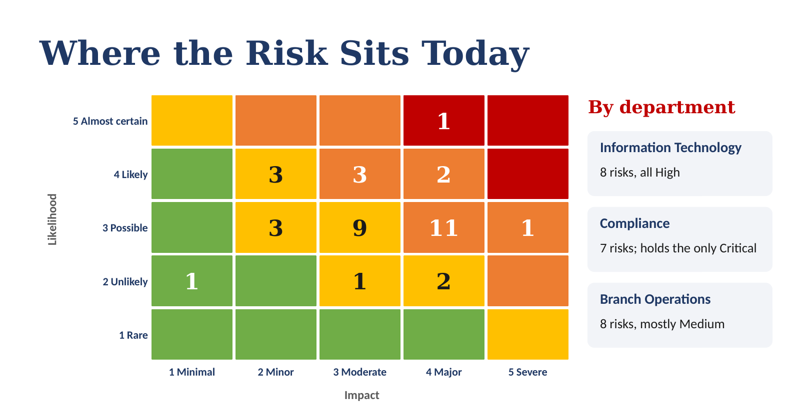

# 🏦 Financial Institution: Risk Assessment Framework

A complete risk management framework for a community bank: a policy, a procedure, a validated 37-risk register, reusable templates and a Board briefing. The bank had been rating risk on gut feel, department by department. This project gave everyone the same rulebook.

> **Note:** This project is based on a real client engagement delivered through Amdari. The organisation, people and identifying details have been changed to protect client confidentiality, so names, dates and approval records are illustrative.

---

## 📂 See the Work

| # | Document | What it is |
|---|---|---|
| 1 | [Project Charter](documents/01-Project-Charter.docx) | Scope, stakeholders, governance, timeline and success criteria |
| 2 | [Incident Analysis](documents/02-Incident-Analysis.docx) | The six incidents, their root causes and the regulatory requirements behind them |
| 3 | [Stakeholder Interview Findings](documents/03-Stakeholder-Interview-Findings.docx) | Risks identified department by department |
| 4 | [Risk Register](documents/04-Risk-Register.xlsx) | 37 risks with automatic ratings, a dashboard, heat map and validation log |
| 5 | [Risk Management Policy](documents/05-Risk-Management-Policy.docx) | 5 × 5 rating method, acceptance authority and 13 control statements |
| 6 | [Risk Management SOP](documents/06-Risk-Management-SOP.docx) | Step-by-step procedures for identifying, assessing, treating and monitoring risk |
| 7 | [Templates Pack](documents/07-Risk-Assessment-Templates-Pack.docx) | Interview guide, interview notes, summary report and quarterly report templates |
| 8 | [Summary Report](documents/08-Risk-Assessment-Summary-Report.docx) | Results, top risks, findings, decisions needed and roadmap |
| 9 | [Executive Presentation](documents/09-Executive-Presentation.pptx) | 12-slide briefing for the CEO, executives and Board |

*GitHub downloads these files instead of showing them. Open them in Word, Excel and PowerPoint.*

---

## 🎯 The Scenario

The client is a US community bank with over $400 million in assets, about 120 staff and five locations. Its risk practices didn't grow with the bank, and six incidents made that obvious:

| # | Incident | What happened |
|---|---|---|
| 1 | System outage | Online banking went down for 8 hours and cost $15,000 to fix |
| 2 | Key employee left | One person's departure stalled loan processing |
| 3 | Fraud attempt | A fraud attempt nearly succeeded |
| 4 | Privacy breach | Customer records were thrown away improperly |
| 5 | Client losses | Two major commercial clients left, and one cited weak risk management |
| 6 | Regulatory finding | Examiners flagged inadequate risk documentation |

Every department managed risk its own way, so the same risk got a different rating depending on who you asked.

---

## 🧭 How I Approached It

The project moved from understanding the problem to handing over a framework the bank could run itself.

| Stage | What I did | Output |
|---|---|---|
| Discover | Analysed the six incidents and researched US community bank requirements | Project Charter, Incident Analysis |
| Design | Built the rating method: likelihood and impact scales, matrix, priority bands, acceptance and treatment rules | Risk Management Policy |
| Identify | Worked through risks with six departments | Interview Findings: 32 risks, 20 of them new |
| Assess | Built, scored and validated the register | Risk Register v1 (29 risks), then v2 (37 risks) |
| Embed | Reviewed the policy and wrote the procedures | Policy v1.1, SOP |
| Hand over | Reported results and built reusable templates | Summary Report, Templates Pack, Executive Presentation |

---

## 📏 The Rating Method

Every risk is scored **Likelihood × Impact**, each from 1 to 5, at three points: before controls (inherent), with today's controls (residual) and after planned treatment (target).

Impact is rated across five types: financial, operational, customers and data, regulatory, and reputation. The highest one wins. So the outage that cost $15,000 (financial: 2) but took online banking down for 8 hours (operational: 4) scores an impact of 4.

| Rating | Score | Treatment plan due | Who can accept it |
|---|---|---|---|
| 🔴 Critical | 20–25 | 5 business days | Board only |
| 🟠 High | 10–16 | 15 business days | CEO |
| 🟡 Medium | 5–9 | 30 days | Department head, with Risk Manager agreement |
| 🟢 Low | 1–4 | Normal controls | Risk owner |

---

## 📊 What the Assessment Found

**37 risks across 8 departments.** Today, 1 is Critical and 17 are High. If the treatment plans are delivered, none will be Critical or High, and the average risk score drops from 10.3 to 5.4.

### Top 5 Risks

| ID | Risk | Score | Key action |
|---|---|---|---|
| R-05 | Regulatory action for inadequate risk documentation | 20 Critical | Approve the policy and register, report to the Board quarterly and update the regulator |
| R-01 | Online banking outage | 16 High | Agree a recovery time with the provider, test failover and add a rollback plan for updates |
| R-04 | Improper disposal of customer records | 16 High | Weekly shredding collection, a written disposal procedure and monthly spot checks |
| R-31 | Ransomware on core systems and backups | 15 High | Keep an offline backup, test restores quarterly and add endpoint detection and response |
| R-02 | Key-person dependency in Loan Operations | 12 High | Document loan procedures, cross-train a second processor and plan succession |

### The Common Root Cause

Most of the 37 risks trace back to one thing: work ran on individual people and informal habits, with no documented process or named owner. That's how one resignation stalled loans, and why examiners flagged the bank for missing risk documentation.

---

## ✅ How I Checked the Register

I built eight automated validation rules into the register so bad ratings get caught before they reach a Board report. For example:

- Residual risk can't be higher than inherent risk.
- If controls are rated Not Effective, the residual score must equal the inherent score.
- A risk that already happened in the last year can't be rated below "Possible".
- Accepted risks must sit within the approver's authority (High needs the CEO, Critical needs the Board).

All 37 risks pass. The checks also caught two inconsistent ratings, which I corrected. The register runs on 950 formulas with no errors.

---

## 🌍 Frameworks and Regulations

| Reference | What it is | How I used it |
|---|---|---|
| ISO 31000:2018 | International risk management guidelines | Structure of the identify, assess, treat and monitor process |
| 12 CFR Part 364 (Appendices A and B) | US FDIC safety and soundness standards, including information security | Board reporting, control and documentation requirements |
| 12 CFR Part 304, Subpart C | US rule requiring banks to notify regulators of significant cyber incidents within 36 hours | Incident escalation control (RM-C11) |
| 12 CFR Part 353 | US Suspicious Activity Report rules for FDIC-supervised banks | Fraud and suspicious activity escalation |
| FFIEC IT Examination Handbook | US bank examiner guidance on IT risk | Risk review frequency |

---

## 💡 Key Learning

- **Interviews find what documents miss.** 20 of the 32 risks raised by departments weren't in any record.
- **Define terms before anyone rates anything.** Inherent, residual and control effectiveness got applied differently until I wrote clear definitions into the policy.
- **Validate before you report.** A rating that looks fine on its own can clash with a similar risk two rows down.
- **Plan for after handover.** A register with no owner is a spreadsheet with a short shelf life. That's why "appoint a Risk Manager" is the first decision I asked leadership for.

---

## 🛠️ Tools

- Microsoft Excel (formulas, conditional formatting, data validation, dashboard)
- Microsoft Word
- Microsoft PowerPoint
- GitHub and Markdown
